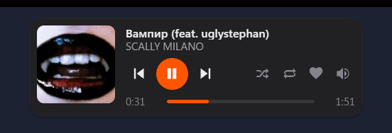
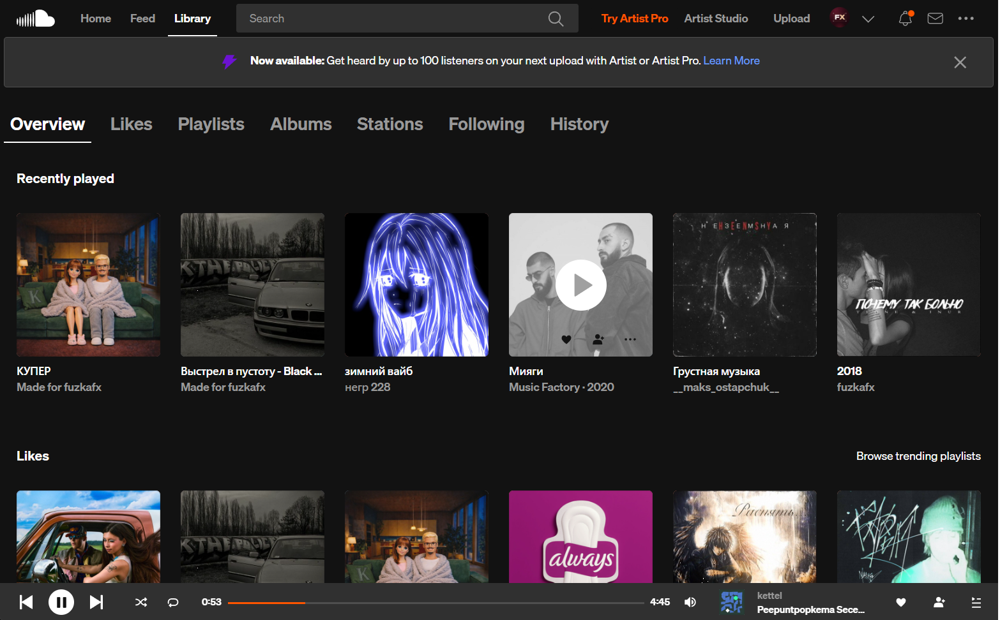
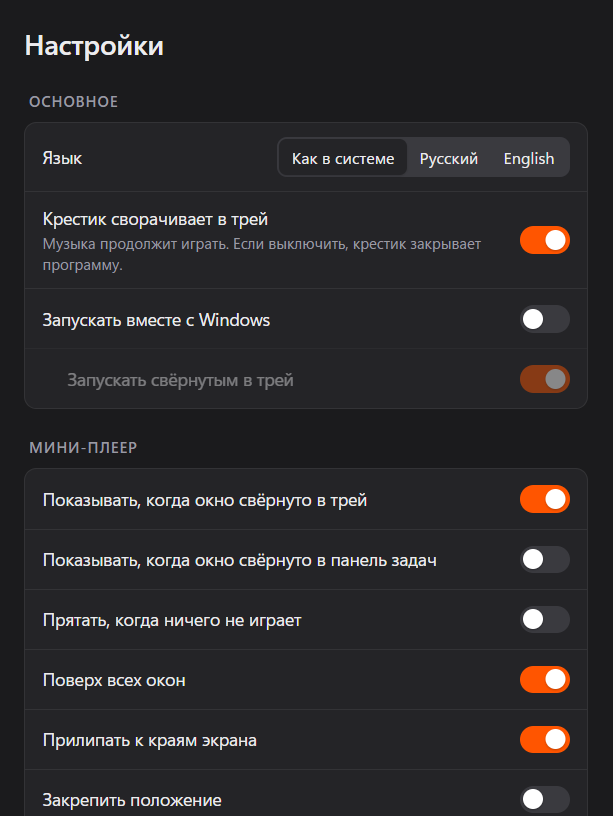

# SoundCloud Desktop

Unofficial desktop client for [soundcloud.com](https://soundcloud.com) on Windows, with a mini player widget that stays on screen while the app is in the tray.

**[Русский](#русский)** · **[English](#english)**

> Not affiliated with, endorsed or sponsored by SoundCloud. It is the regular SoundCloud website in its own window, nothing is modified or downloaded.

<p align="center">
  
</p>

<p align="center">
  <a href="https://github.com/fuzkafx/soundcloud-desktop/releases/latest"><b>⬇ Download for Windows / Скачать для Windows</b></a>
</p>



<p align="center">
  
</p>

---

## Русский

### Установка

1. Скачайте `SoundCloud-Desktop-Setup-x.x.x.exe` со страницы [Releases](https://github.com/fuzkafx/soundcloud-desktop/releases/latest).
2. Запустите установщик. Windows SmartScreen может предупредить, что издатель неизвестен (у установщика нет платной подписи): нажмите «Подробнее» → «Выполнить в любом случае».
3. Войдите в свой аккаунт SoundCloud в окне программы. Вход сохраняется.

Чтобы закрепить на панели задач, нажмите правой кнопкой на значок запущенной программы → «Закрепить на панели задач».

### Возможности

- Отдельное окно вместо вкладки браузера, своя иконка на панели задач.
- Крестик сворачивает в трей, музыка продолжает играть.
- **Мини-плеер** поверх окон: обложка, название, перемотка, назад / пауза / вперёд, лайк, перемешивание и повтор, **громкость** (кнопка или колесо мыши над плеером).
- Компактный и обычный размер, тёмная, светлая, системная тема или цвет по обложке, свой акцентный цвет, прозрачность и масштаб.
- Прилипание к краям экрана, закрепление положения, контекстное меню по правому клику.
- Кнопки управления на превью окна в панели задач, медиаклавиши клавиатуры.
- Запуск вместе с Windows (можно сразу в трей).
- Интерфейс на русском и английском.

### Настройки

Открываются тремя способами: правой кнопкой по значку в трее → «Настройки…», правой кнопкой по мини-плееру → «Настройки…» или `Ctrl+,` в главном окне.

- **Основное:** язык, что делает крестик (в трей или выход), автозапуск с Windows.
- **Мини-плеер:** когда показывать, поверх всех окон, прилипание к краям, закрепление положения, регулятор громкости, кнопки «Перемешать» и «Повтор».
- **Внешний вид:** размер (обычный или компактный), тема, акцентный цвет, непрозрачность, масштаб.

Самое нужное есть и в меню по правому клику на мини-плеере.

### Горячие клавиши

| Клавиши | Действие |
|---|---|
| `Alt+←` / `Alt+→` | Назад / вперёд по страницам |
| `F5`, `Ctrl+R` | Обновить страницу |
| `Ctrl+,` | Настройки |
| `Ctrl+Q` | Выход |

---

## English

### Install

1. Download `SoundCloud-Desktop-Setup-x.x.x.exe` from [Releases](https://github.com/fuzkafx/soundcloud-desktop/releases/latest).
2. Run it. Windows SmartScreen may warn about an unknown publisher (the installer is not code-signed): click "More info" → "Run anyway".
3. Sign in to SoundCloud inside the app. The session is kept between launches.

To pin it, right-click the running app's taskbar icon → "Pin to taskbar".

### Features

- Its own window and taskbar icon instead of a browser tab.
- The close button sends it to the tray, music keeps playing.
- **Mini player** that floats on top: artwork, title, seek bar, previous / play-pause / next, like, shuffle and repeat, **volume** (button or mouse wheel over the player).
- Normal and compact sizes; dark, light, system or artwork-based theme; custom accent color, opacity and scale.
- Snaps to screen edges, can be locked in place, right-click menu.
- Taskbar thumbnail buttons and keyboard media keys.
- Start with Windows (optionally straight to the tray).
- Russian and English UI.

### Settings

Open them from the tray icon (right-click → "Settings…"), by right-clicking the mini player, or with `Ctrl+,` in the main window.

- **General:** language, what the close button does (tray or quit), start with Windows.
- **Mini player:** when to show it, always on top, snap to edges, lock position, volume control, Shuffle and Repeat buttons.
- **Appearance:** size (normal or compact), theme, accent color, opacity, scale.

The most used options are also in the mini player's right-click menu.

### Shortcuts

| Keys | Action |
|---|---|
| `Alt+←` / `Alt+→` | Back / forward |
| `F5`, `Ctrl+R` | Reload |
| `Ctrl+,` | Settings |
| `Ctrl+Q` | Quit |

---

## Build from source

Requires Node.js 18+ on Windows.

```bash
npm install
npm start          # run in development
npm run dist       # build the installer into dist/
```

`npm run icons` regenerates `assets/icon.ico` and the thumbnail button images.

Releases are also built automatically by GitHub Actions when a `v*` tag is pushed (see `.github/workflows/build.yml`).

## Privacy / Приватность

This program will not transfer any information to other networked systems unless specifically requested by the user or the person installing or operating it. It only loads soundcloud.com (and the sign-in pages you choose); what SoundCloud collects is covered by the [SoundCloud privacy policy](https://soundcloud.com/pages/privacy). Settings and your session are stored locally in `%APPDATA%\SoundCloud Desktop`.

Программа ничего не отправляет никуда, кроме самого soundcloud.com и выбранной вами страницы входа. Настройки и вход хранятся только на вашем компьютере в `%APPDATA%\SoundCloud Desktop`.

## Uninstall / Удаление

Windows Settings → Apps → SoundCloud Desktop → Uninstall. / Параметры Windows → Приложения → SoundCloud Desktop → Удалить.

## License

[MIT](LICENSE)
